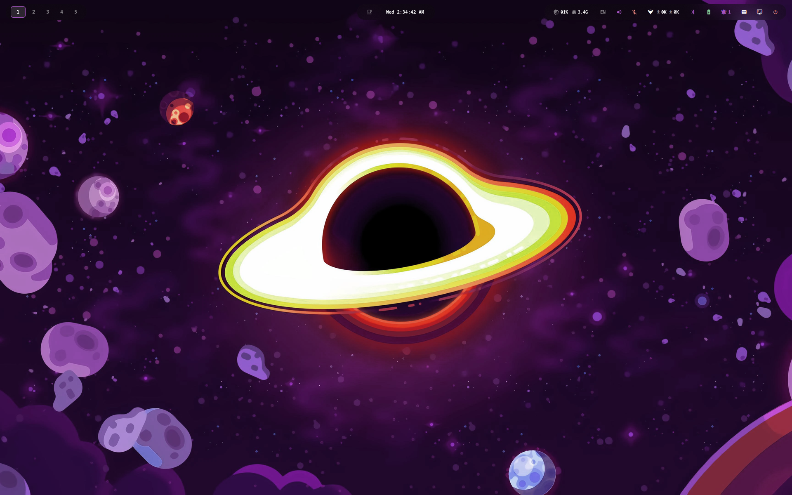
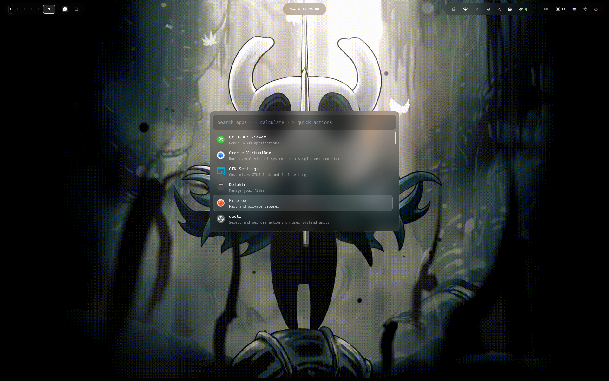
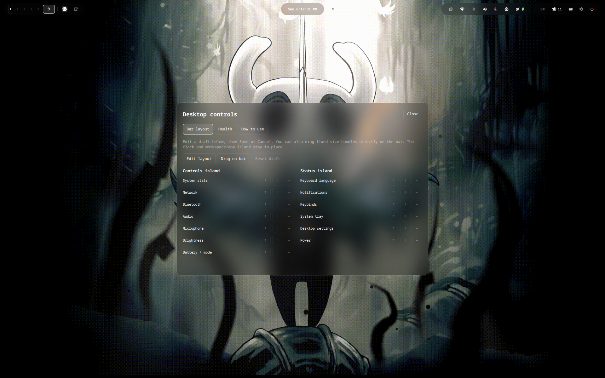

<div align="center">

# HyprDodz

My CachyOS desktop · Hyprland + Quickshell · Managed with chezmoi

[](https://github.com/Dodzux/HyprDodz/actions/workflows/checks.yml)


[Setup](#quick-start--reproduction) · [Hardware](#hardware--portability) · [Keybindings](#keybinding-highlights) · [Maintenance](#dotfiles-management-cheatsheet)

</div>



## What makes it mine

- Wallpaper colors shared across apps, the cursor and RGB lighting.
- A custom Quickshell bar, launcher, calculator and workspace overview.
- Rearrangeable bar controls with brightness, battery and desktop settings.
- Hardware profiles for my ASUS ROG Strix G16 and Logitech G305.

| App launcher | Desktop controls |
| :---: | :---: |
| [](assets/screenshots/launcher.png) | [](assets/screenshots/controls.png) |

[▶ Watch the desktop tour — MP4, 60 FPS](assets/videos/demo.mp4)

Apps, calculator, wallpapers, bar controls, capture tools, tiling and workspaces. Feature labels and chapters are included in the video.

---

Desktop and personal app settings for **CachyOS**, intended for an existing Arch-family installation.

## Quick Start & Reproduction

Download the configs, inspect the changes, then apply the files you want:

```bash
# 1. Install the dotfile manager
sudo pacman -S --needed chezmoi git

# 2. Download and review
chezmoi init Dodzux/HyprDodz
chezmoi diff --exclude=scripts

# 3. Apply with confirmation; defer the setup hooks
chezmoi apply --interactive --exclude=scripts
```

Initialization asks for the name shown on the lock screen and greeter, and detects the GPU vendor. A machine without a matching host profile uses automatic monitor settings.

Review [packages/](packages/) and install the categories needed for your machine. Some entries use CachyOS packages or may need another package source on Arch. **Brave** is installed separately (`brave-bin` on my machine); optional personal apps such as Codex also need their own installation.

For full setup, review [scripts/bootstrap.sh](scripts/bootstrap.sh). It upgrades the system, installs packages and GPU drivers, configures Fish, SDDM and services, and force-applies the configs:

```bash
~/.local/share/chezmoi/scripts/bootstrap.sh
```

For manual setup, `~/.config/hypr/scripts/bootstrap.sh` configures desktop user services after package installation. See the [restore notes](docs/reports/restore-on-new-install.md) for details.

---

## System & Application Stack

| Component | Choice | My setup |
| --- | --- | --- |
| Compositor | Hyprland | Modular Lua config, launched directly |
| Greeter | SDDM | Custom `hypr-sddm` theme |
| Bar & panels | Quickshell | QML bar, launcher, clipboard, notifications, overview and wallpaper selector |
| Terminal | Kitty | Default terminal; Ghostty settings are also included |
| Shell | Fish + Starship | Modular shell files and a custom prompt |
| Editor | Neovim + NvChad | Lua configuration, plugins and language tooling |
| File manager | Yazi | Opens inside Kitty |
| Browser | Brave | Default browser on `SUPER + B` |
| Wallpaper | awww | Animated wallpapers and random transitions |
| Lock & idle | hyprlock + hypridle | Lock screen, idle blanking and display power management |
| GTK & Qt | Graphite-Dark + Kvantum + qt6ct | Dark appearance with wallpaper accents |
| Icons & cursor | Tela circle black + Bibata-Modern-Ice | Bundled icons and generated accent cursor variants |
| RGB | Native HID helpers + OpenRGB fallback | ASUS keyboard and Logitech G305 indicator |

### Wallpaper accents

`hypr/scripts/sync_border.py` keeps desktop, app and RGB accents matched to the wallpaper. `sync_cursor.py` creates a colored Bibata cursor variant.

Templates read `~/.local/state/hypr/accent`, preserving the selected color when applying configs. A fresh machine defaults to `#e5e5e5`; choose a wallpaper with `SUPER + Space`.

```bash
# Preview a wallpaper's accent without applying it
~/.config/hypr/scripts/sync_border.py --dry-run ~/Pictures/Wallpapers/your-image.png
```

Accent-bearing configs are templates: `chezmoi re-add` skips them. Edit their source with `chezmoi edit` and retain the template expressions.

---

## Hardware & Portability

### My machine

| Part | Hardware / configuration |
| --- | --- |
| Laptop | ASUS ROG Strix G16 G614PH |
| CPU | AMD Ryzen 9 8940HX |
| GPUs | NVIDIA GeForce RTX 5050 Laptop GPU + AMD Radeon 610M |
| Host profile | `Potat0Mac.lua` |
| Internal display | `eDP-1`, 1920×1200 at 165 Hz, scale 1 |
| External displays | Preferred mode, automatic placement |
| Keyboard | US / Arabic; switch with `SUPER + K` |
| Touchpad | Natural scrolling, tap to click, disabled while typing |
| Mouse | Logitech G305 with wallpaper-driven indicator color |

### Host profiles

[hosts/init.lua](dot_config/hypr/hosts/init.lua) selects a profile by hostname, falling back to `default.lua`.

```text
~/.config/hypr/hosts/
├── init.lua          # Profile loader
├── default.lua       # Automatic settings for other machines
└── Potat0Mac.lua      # My ASUS G614PH laptop
```

Profiles hold monitor rules, input/device overrides, app commands and optional GPU environment settings. To add your machine:

```bash
profile="$(cat /proc/sys/kernel/hostname)"
cp ~/.config/hypr/hosts/default.lua ~/.config/hypr/hosts/"$profile".lua
# Edit the new profile, then save it into chezmoi:
chezmoi add ~/.config/hypr/hosts/"$profile".lua
```

### GPU selection

My AMD/NVIDIA laptop uses automatic GPU selection. Other profiles can set GPU addresses and environment overrides through [modules/environment.lua](dot_config/hypr/modules/environment.lua).

`chezmoi init` detects the GPU vendor; bootstrap selects the matching package list, prioritizing NVIDIA on my hybrid system. Review drivers for your hardware and re-run initialization after changing GPUs.

### Keyboard & mouse lighting

Native helpers sync the G614PH keyboard and G305 indicator to the wallpaper. Other board models use the OpenRGB fallback.

OpenRGB supplies device access rules; run the helpers as your normal user. The native path excludes the OpenRGB server. Keep `openrgb_color.sh.before-g614ph`: it is the active fallback for other hardware.

See the [RGB review](docs/reports/native-mouse-upload-review.md) for device requirements and checks.

---

## Categorized Package Manifests

The full bootstrap reads [packages/](packages/). App settings and package installation are separate: the repository retains more personal configs than the manifests install.

| Manifest | Contents |
| --- | --- |
| `10-hyprland.txt` | Hyprland, Quickshell, awww, lock/idle tools, screenshots and desktop daemons |
| `20-apps.txt` | Neovim, Micro, Firefox, Obsidian, OBS, Inkscape, OpenRGB and other apps |
| `30-shell.txt` | Fish, Starship, Yazi, Git/GitHub CLI and command-line tools |
| `40-terminals.txt` | Kitty and Ghostty |
| `50-fonts.txt` | Noto, emoji, UI fonts and Cascadia Code Nerd Font |
| `60-audio-media.txt` | PipeWire, WirePlumber, ALSA and media codecs |
| `70-theming.txt` | GTK/Qt tooling, Kvantum, qt6ct and Tela icons |
| `80-gpu-amd.txt` / `80-gpu-intel.txt` / `80-gpu-nvidia.txt` | Vendor-specific GPU packages |
| `90-networking.txt` | NetworkManager, Bluetooth, OpenSSH and firewall tools |
| `95-extra.txt` | Additional desktop utilities |

Firefox remains in the application list; Brave is the configured browser. Theme assets are bundled in the repo, while bootstrap can fetch Graphite-Dark if it is missing.

---

## Keybinding Highlights

`SUPER` is the Windows key. Press `SUPER` + `H` for the complete interactive shortcut list.

| Shortcut | Action |
| --- | --- |
| `SUPER` + `T` | Open Kitty |
| `SUPER` + `E` | Open Yazi in Kitty |
| `SUPER` + `B` | Open Brave |
| `SUPER` + `C` | Open Neovim in Kitty |
| `SUPER` + `X` | Open Codex in Kitty, if installed |
| `SUPER` + `O` | Open Obsidian |
| `SUPER` + `U` | Run `sudo pacman -Syu` in Kitty to update the system |
| `SUPER` + `A` | Show/hide the app launcher |
| `SUPER` + `F` | Toggle keyboard focus on the bar |
| `SUPER` + `Space` | Show/hide the wallpaper selector |
| `SUPER` + `V` | Show/hide clipboard history |
| `SUPER` + `H` | Show/hide the interactive shortcut list |
| `SUPER` + `Backspace` | Show/hide the menu for lock, suspend, logout, restart and shutdown |
| `SUPER` + `S` | Show/hide the `terminal` special workspace |
| `SUPER` + `N` | Show/hide the `notes` special workspace |
| `SUPER` + `K` | Cycle keyboard layouts (US / Arabic by default) |
| `SUPER` + `Shift` + `W` | Choose another random wallpaper and sync its accent |
| `SUPER` + `Shift` + `P` | Pick a screen color and apply it to RGB lighting |
| `SUPER` + `I` | Pick a screen color and copy it to the clipboard |
| `SUPER` + `L` | Lock the current session |
| `Print` | Show/hide the screenshot menu: copy, save, or both |
| `F11` | Select a screen region and copy its image to the clipboard |
| `F12` | Select a screen region and open it in Satty for annotation |
| `SUPER` + `Print` | Capture the focused monitor and push the README preview; close all windows first |

Edit shortcuts in [modules/keybindings.lua](dot_config/hypr/modules/keybindings.lua) and app commands in [modules/variables.lua](dot_config/hypr/modules/variables.lua).

---

## System Files

[system/](system/) is excluded from home deployment.

| Path | Purpose |
| --- | --- |
| `etc/sddm.conf` | SDDM configuration |
| `usr/share/sddm/themes/hypr-sddm/` | Custom greeter theme |
| `user/` | Browser preferences, dconf and directory-mode snapshots |

Bootstrap installs the greeter. Browser and dconf snapshots are restored manually; directory modes use the apply hook. See the [restore notes](docs/reports/restore-on-new-install.md).

---

## Dotfiles Management Cheatsheet

```bash
# Check modified files against repo
chezmoi status
chezmoi diff

# Edit a managed file
chezmoi edit ~/.config/hypr/hyprland.lua

# Add a newly created configuration file
chezmoi add ~/.config/newapp/config

# Pull edits made in ~/.config back into the repo (skips templates — see above)
chezmoi re-add

# Change per-machine data (display name; GPU is re-detected)
chezmoi init

# Re-apply repository state to the system
chezmoi apply

# Commit and push changes to GitHub
chezmoi cd
git add .
git commit -m "Update configurations"
git push
```

### Repository layout

| Path | Contents |
| --- | --- |
| `dot_config/hypr/` | Hyprland modules, host profiles, scripts and user units |
| `dot_config/quickshell/` | Bar, panels and shared UI theme |
| Other `dot_config/` folders | Fish, Kitty, Neovim, Yazi and personal app settings |
| `dot_local/` | Launchers, desktop entries, icons, cursors and theme variants |
| `dot_themes/` | GTK theme assets |
| `Pictures/Wallpapers/` | Wallpapers and GIFs |
| `.chezmoitemplates/` | Shared accent and cursor templates |
| `packages/` | Package manifests |
| `scripts/` | Full bootstrap, showcase capture, audits and snapshot helpers |
| `system/` | Greeter and supplemental settings |
| `docs/reports/` | Detailed restore and verification records |
| `assets/` | Screenshots and desktop tour |
| `.github/workflows/` | Automatic config checks |

All existing app configs are kept, including OBS, Micro, Inkscape, Discord, Obsidian, OpenRGB, Qt/KDE tools and Git. Most repository files are bundled icons and themes; desktop customization starts in `dot_config/hypr/` and `dot_config/quickshell/`.

Accounts, credentials, browser sessions, caches, generated accent cursors and oversized wallpapers stay local. The [coverage report](docs/reports/config-coverage.md) records the last comparison with live files. Refresh it from the repo root with:

```bash
python3 scripts/audit-configs.py --report docs/reports/config-coverage.md
```

---

## Updating the Showcase Screenshot

Close all windows and press `SUPER + Print`. [scripts/showcase.sh](scripts/showcase.sh) captures the desktop preview, commits it and pushes it using your GitHub authentication.

### Config checks

Pushes to `main` and `master`, and pull requests, run syntax checks, template rendering and regression tests. Run the same checks locally with:

```bash
python3 scripts/check-configs.py
```

Requires Python (NumPy and Pillow), Bash, Fish, Lua, Qt's `qmllint`, `desktop-file-validate` and chezmoi. Checks use temporary data and mocked hardware; they do not apply configs. QML type-analysis warnings are reported separately from syntax errors.

[Tagged snapshots](https://github.com/Dodzux/HyprDodz/releases) keep a fixed version available for recovery.

---

## Credits

Based on [BodzTH/hyprconfigs](https://github.com/BodzTH/hyprconfigs), adapted for my ASUS laptop, apps, wallpaper accents and RGB hardware. Bundled themes and icons retain their upstream license files.
